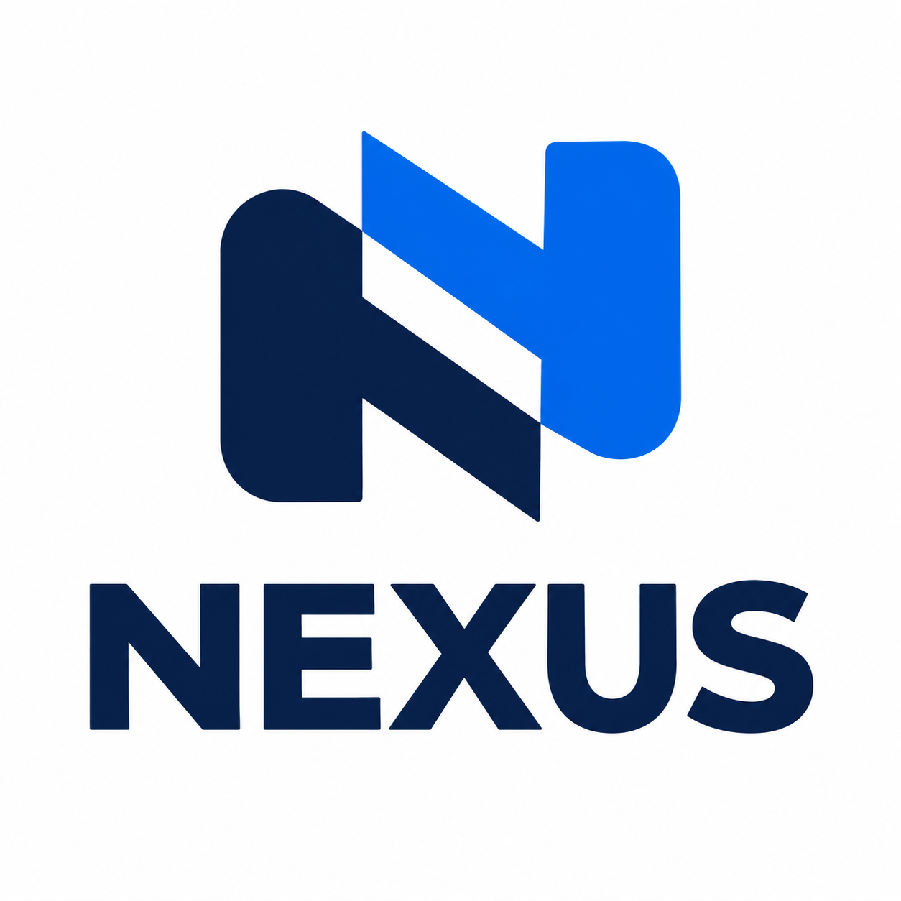

# NEXUS + A.R.Y.O.S.

 

NEXUS + A.R.Y.O.S. integra una plataforma de gestión educativa con dispositivos
de asistencia mediante tarjetas RFID. Reúne asistencia, calificaciones, trabajos,
comunicados y seguimiento de estudiantes, con funciones diferenciadas por rol.

La implementación está orientada a una institución educativa completa.

## Docentes titulares y adultos responsables

- **Leandro Boned**
- **Víctor Imobedorff**

## Estado documentado

Al **12/11/2026**, el equipo estima un avance general de **aproximadamente 90%**.
Se avanzó en el servidor, el campus, los clientes Android y Windows y la activación
de cuentas por correo. La integración RFID completa continúa en validación.

[Consultar avances y pruebas pendientes](docs/ACTUALIZACION_AVANCES_2026-11-12.md).

## Documentación

1. [Presentación del proyecto y equipo](docs/01_INFORME_MUNICIPALIDAD.md)
2. [Índice general](docs/00_INDICE_GENERAL.md)
3. [Informes mensuales](docs/informes_avance/00_INDICE_INFORMES_AVANCE.md)
4. [Informe del segundo mes](docs/INFORME_AVANCE_MES_2_NEXUS_ARYOS.md)
5. [Informe del tercer mes](docs/INFORME_AVANCE_MES_3_NEXUS_ARYOS.md)
6. [Informes semanales](docs/informes_semanales/00_INDICE_INFORMES_SEMANALES.md)
7. [Informes complementarios](docs/informes_complementarios/)

## Datos del proyecto

- **Municipalidad:** Municipalidad de San Martín.
- **Inicio:** 06/08/2026.
- **Finalización prevista:** 26/11/2026.
- **Aporte municipal otorgado:** $1.180.000 argentinos, mediante el Fondo Municipal
  de Innovación Educativa 2026.

Este repositorio publica documentación y material de presentación. El código,
los instaladores, las bases de datos, las credenciales y los archivos editables
de fabricación se conservan en el entorno privado del equipo.
