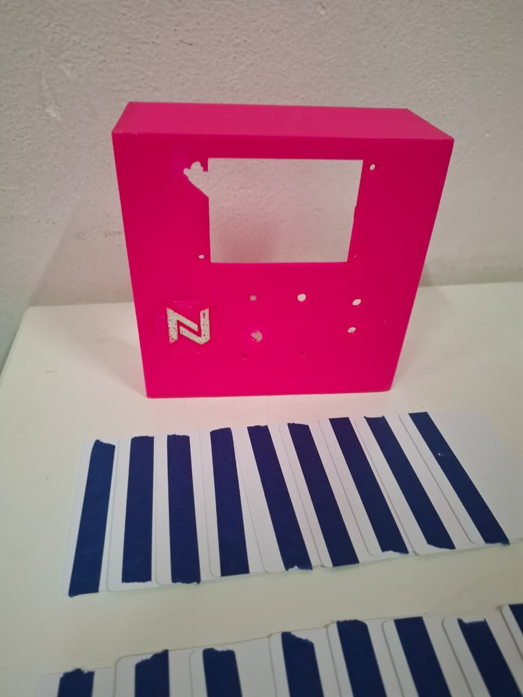
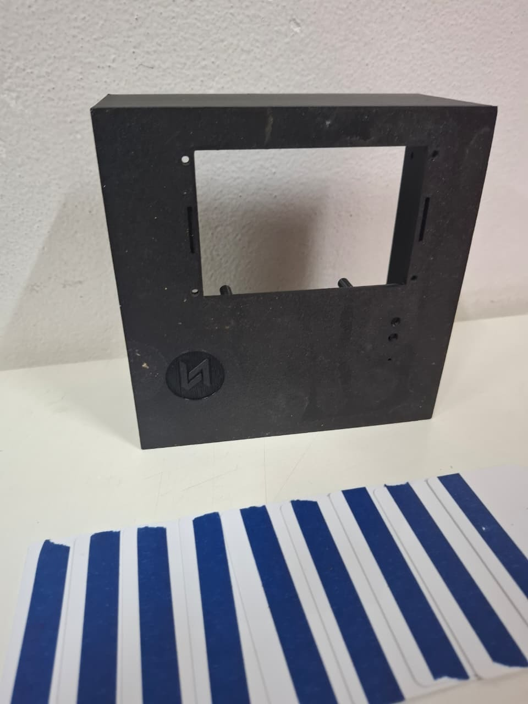
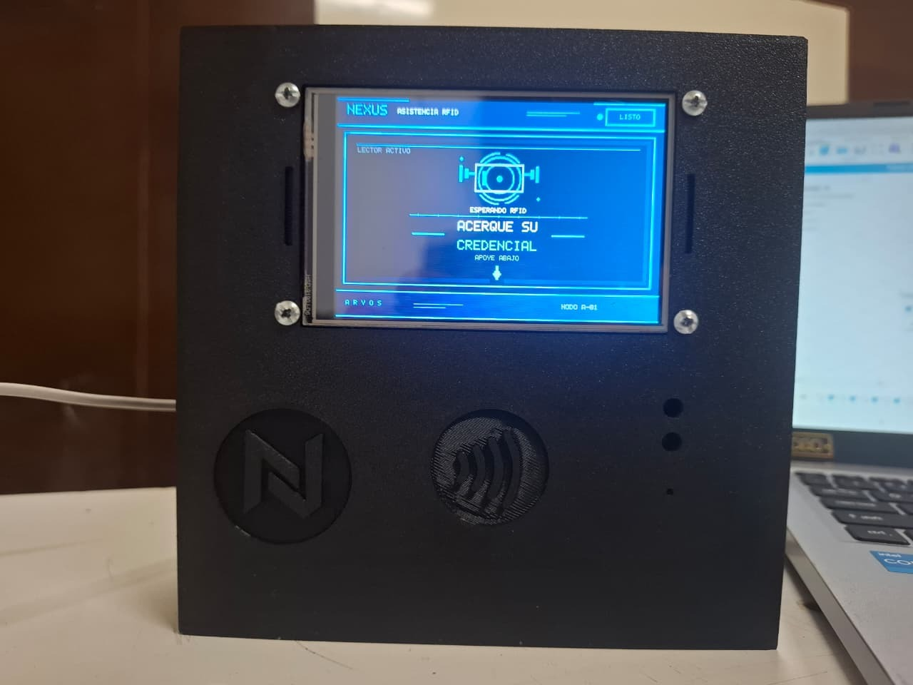
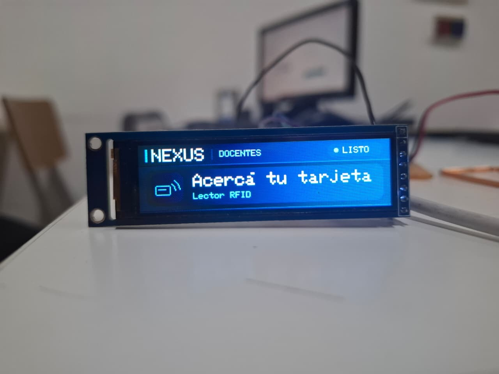
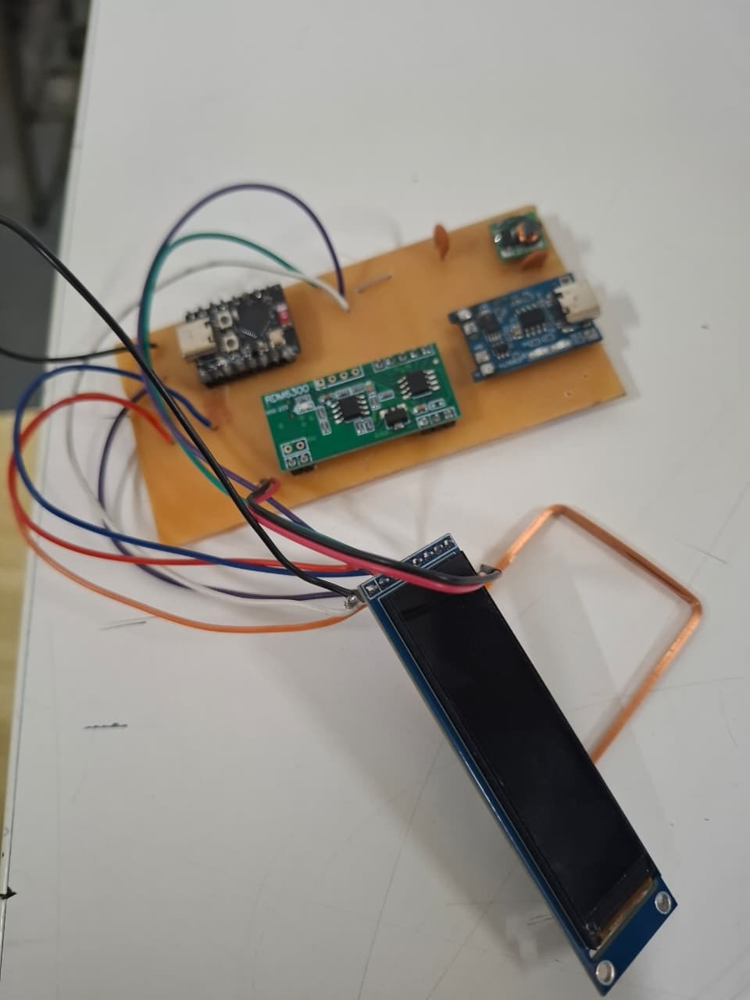
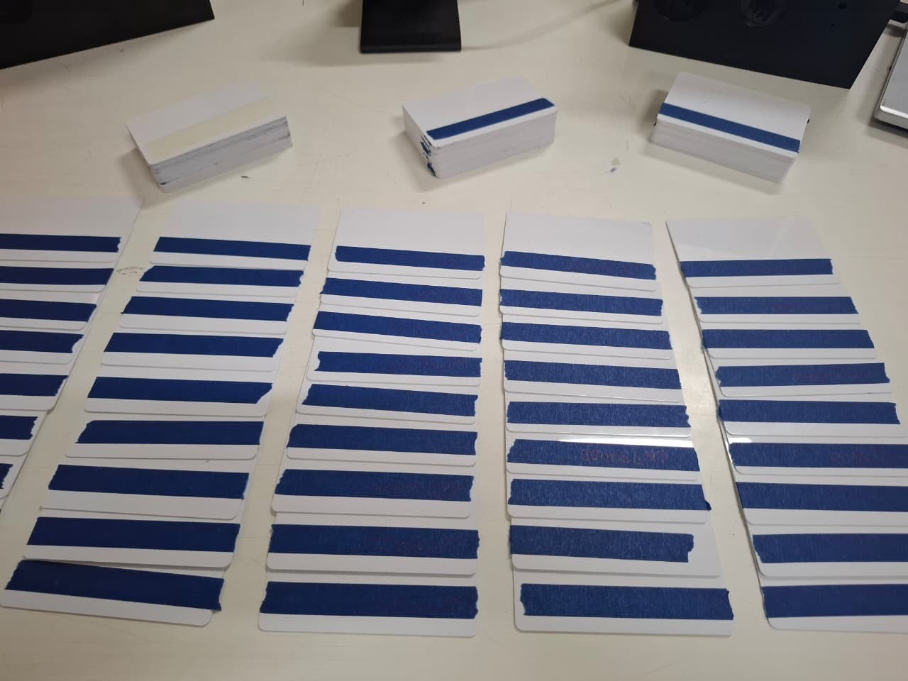

# Registro fotográfico de NEXUS

Las fotografías del 20 de noviembre de 2026 muestran la evolución de la carcasa del módulo principal, el mini módulo para docentes y las credenciales RFID.

## Evolución del módulo principal

**Primer modelo de carcasa, en rosa.**

**Segundo modelo: carcasa negra vacía, con la abertura para la pantalla.**

**Tercer modelo: carcasa negra con la pantalla montada, encendida y en espera de una credencial.**

## Mini módulo para docentes

El equipo desarrolló un prototipo compacto para docentes, con pantalla propia y lectura de tarjetas RFID.

**Pantalla del mini módulo para docentes con el mensaje «Acercá tu tarjeta».**

**Montaje del mini módulo con la pantalla compacta, el lector y la antena RFID, las placas y el cableado.**

## Credenciales RFID

El registro documenta el montaje físico y las pantallas en espera de una credencial. La validación de punta a punta del registro de asistencia se documenta por separado en los [informes de avance](informes_avance/00_INDICE_INFORMES_AVANCE.md).
